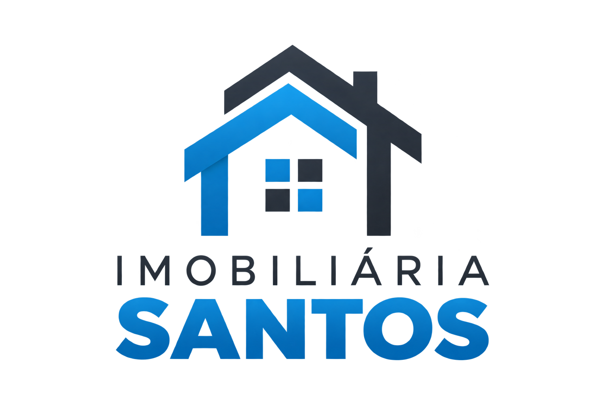

# Imobiliária Santos

Página institucional de uma imobiliária, criada como projeto pessoal para praticar desenvolvimento web.

## Tecnologias

- HTML5
- CSS3

## Estrutura do projeto

```text
.
├── index.html
├── style.css
├── README.md
└── img/
    ├── banner.png
    ├── corretores.png
    ├── imovel-assinatura.png
    └── logo.png
```

Mantenha `index.html`, `style.css` e a pasta `img` no mesmo nível. Os caminhos das imagens no HTML devem ser relativos à página, por exemplo:

```html

```

## Como abrir localmente

Abra `index.html` no navegador. Para atualizar a página automaticamente enquanto edita, você também pode usar a extensão Live Server no Visual Studio Code.

## Publicação

Este projeto usa arquivos estáticos de HTML e CSS, sem etapa de compilação. Ele pode ser conectado a um serviço de hospedagem como a Vercel.

## Observação

Este projeto é demonstrativo. Atualize textos, imagens, telefone, registro profissional e links antes de usar como site de uma imobiliária real.
